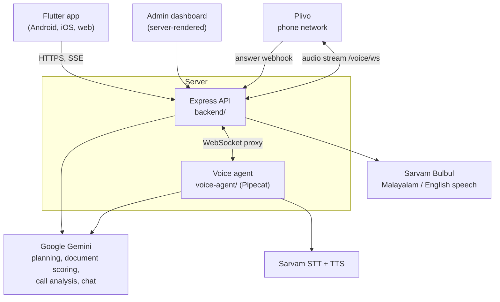

<p align="center">
  
</p>

<p align="center"><b>Real trips. Real budgets. Ready to go.</b></p>

Travelgram is a social travel platform that doubles as a client-acquisition engine for travel and visa businesses.

- **Part 1: social platform.** Creators track and share real itineraries: every place, photo and expense. Travellers browse by destination and budget, follow creators and tap **“I’m going”** on trips they want to take.
- **Part 2: client acquisition.** A smart document checker scores a traveller's visa readiness. Travellers who score **70+** and agree to be contacted get an **automatic AI phone call** (Malayalam or English) that asks where, when, how many and what they enjoy. The call is analysed, and the sales team sees each lead's **strength** in a CRM dashboard.

An in-app **AI travel consultant** plans trips on a budget from real community trips, answers by chat or voice, and lets travellers book stays and activities from an itinerary (demo payments).

---

## Contents

- [How it works](#how-it-works)
- [Architecture](#architecture)
- [Repository layout](#repository-layout)
- [Quick start](#quick-start)
- [Configuration](#configuration)
- [The client-acquisition engine](#the-client-acquisition-engine)
- [Admin dashboard](#admin-dashboard)
- [API reference](#api-reference)
- [Testing](#testing)
- [Deployment](#deployment)
- [Data and privacy](#data-and-privacy)
- [Branding](#branding)
- [Known limitations](#known-limitations)

---

## How it works


| For travellers | For creators | For the business |
|---|---|---|
| Feed (For you / Following), explore by destination and budget bracket | Trip tracker: places by day, photos, expenses by category, custom fields (entry fee, visa, best time…) | Qualified leads with documents already checked |
| Follow creators, like, save, share, “I’m going” | Draft autosaves across days of travel; publish to followers | Automatic AI call within seconds of qualifying |
| AI consultant: budget planner, chat, phone-style call | Profile with trips, followers and following | CRM: stages, live call transcript, recording, documents, CSV export |
| Visa document checker with a readiness score | Every traveller can become a creator | Booking commission (10%) on stays and activities |

## Architecture



- **`backend/`**: Express 5 API. Journeys, creators, follows, “I’m going”, uploads, place search (OpenStreetMap), the AI consultant (Gemini + Sarvam), the budget planner, the document checker, bookings, leads, the Plivo webhooks, the admin dashboard and a WebSocket proxy to the voice agent. JSON-file store.
- **`voice-agent/`**: Python [Pipecat](https://github.com/pipecat-ai/pipecat) pipeline for phone calls. Plivo audio → Sarvam speech-to-text → Gemini → Sarvam Bulbul text-to-speech → Plivo, with noise suppression and turn-taking tuned for phone lines.
- **`app/`**: Flutter app with five tabs (Home · Explore · ☎ AI Agent · Desk · Profile). Create opens from the **+** on Home.

## Repository layout

```
.
├── app/                      Flutter app
│   ├── lib/
│   │   ├── data/             API client, models, session, optimistic reactions
│   │   ├── features/
│   │   │   ├── home/         feed, post cards
│   │   │   ├── explore/      destinations, search, budget brackets
│   │   │   ├── journey/      trip page, photo viewer
│   │   │   ├── create/       trip tracker, place editor, publish (draft autosave)
│   │   │   ├── profile/      profile, trips / going / saved / plans
│   │   │   ├── desk/         Travel desk: document checker + trip planner
│   │   │   ├── documents/    smart document check
│   │   │   ├── planner/      budget planner, plan page, lead form
│   │   │   ├── booking/      demo booking + payment sheet
│   │   │   ├── ammachi/      AI consultant chat, call screen, avatar (internal name)
│   │   │   ├── onboarding/   sign-up (name, handle, phone, consent)
│   │   │   └── shell/        bottom navigation
│   │   ├── theme/ util/ widgets/
│   ├── assets/               fonts (DM Sans, Noto Sans Malayalam), branding
│   └── test/                 logic + widget flow tests
├── backend/                  Express API
│   ├── src/
│   │   ├── routes/           journeys, creators, places, uploads, ammachi (AI consultant),
│   │   │                     planner, documents, bookings, voice, dashboard
│   │   ├── ammachi/          persona, catalogue retrieval, offline replies, Gemini client
│   │   ├── voice/plivo.js    outbound calls
│   │   ├── documents.js      document scoring
│   │   ├── leads.js          lead scoring and CRM stages
│   │   ├── planner.js        budget planner
│   │   └── store.js          JSON-file database
│   ├── scripts/              seed builder, DB reset, specimen-document generator
│   ├── data/seed.json        seeded creators and trips
│   ├── public/               seed photos, brand icons, TTS cache, uploads, APK download
│   └── test/api.test.js
├── voice-agent/              Pipecat phone agent
│   ├── bot.py                FastAPI websocket server + pipeline
│   ├── capture.py            noise handling for phone lines
│   └── tests/                unit tests + live end-to-end call tests
└── branding/                 logo sources (SVG) and rendered PNGs
```

> Internal code still uses the name `ammachi` (from an earlier persona) for the assistant's modules and the `/api/ammachi/*` routes. Users only ever see **“AI Consultant”**.

## Quick start

### Prerequisites

- **Node.js 20.12+** (the backend uses `process.loadEnvFile`)
- **Flutter** stable with Dart 3.12+
- **Python 3.12+** (only for the voice agent)
- API keys: [Google Gemini](https://aistudio.google.com/apikey) and [Sarvam AI](https://dashboard.sarvam.ai). [Plivo](https://www.plivo.com) is only needed for real phone calls.

### 1. Backend

```bash
cd backend
npm install
cp .env.example .env        # then fill in GEMINI_API_KEY and SARVAM_API_KEY
npm start                   # http://localhost:4000
```

On start it prints the LAN address for testing on a phone, which providers are active, and the **admin dashboard URL including its key**.

Without `GEMINI_API_KEY` the assistant still answers from the trip catalogue (labelled *offline*), and document checks fall back to a basic presence check. Without `SARVAM_API_KEY` replies are text-only.

### 2. App

```bash
cd app
flutter pub get
flutter run --dart-define=API_BASE=http://<your-laptop-ip>:4000
```

- `API_BASE` defaults to `http://10.0.2.2:4000` on the Android emulator and to `<page host>:4000` on the web.
- **Long-press the Travelgram wordmark** (Home or sign-up) to point a running app at another server.
- Release build that the backend serves at `/app`:

  ```bash
  flutter build apk --release --dart-define=API_BASE=https://your-domain
  cp build/app/outputs/flutter-apk/app-release.apk ../backend/public/downloads/travelgram.apk
  ```

### 3. Voice agent (optional)

```bash
cd voice-agent
python -m venv .venv
.venv/Scripts/python -m pip install -r requirements.txt     # macOS/Linux: .venv/bin/python
.venv/Scripts/python bot.py                                 # 127.0.0.1:8765
```

The agent reads keys from `backend/.env`. Without `PLIVO_*` and `PUBLIC_URL`, qualified leads are marked **“Call simulated”** and nothing is dialled. See [voice-agent/README.md](voice-agent/README.md).

## Configuration

All settings live in `backend/.env`. [`backend/.env.example`](backend/.env.example) documents them. Never commit `.env`.

| Variable | Default | Purpose |
|---|---|---|
| `PORT` | `4000` | API port |
| `GEMINI_API_KEY` | — | Chat, planner, document scoring, call analysis |
| `GEMINI_MODEL` | `gemini-flash-latest` | Model for everything above |
| `GEMINI_CALL_MODEL` | (`GEMINI_MODEL`) | Optional faster model for voice calls |
| `GEMINI_THINKING_LEVEL` | `LOW` | Keeps voice replies quick |
| `SARVAM_API_KEY` | — | Malayalam/English speech (Bulbul TTS, Saaras STT) |
| `SARVAM_TTS_MODEL` | `bulbul:v3` | TTS model |
| `SARVAM_SPEAKER` | `priya` | Voice (also used by the phone agent) |
| `SARVAM_PACE` | `1.0` | Speaking pace |
| `DASHBOARD_KEY` | generated | Admin dashboard key; if empty, one is generated into `data/dashboard-key.txt` |
| `PLIVO_AUTH_ID`, `PLIVO_AUTH_TOKEN` | — | Plivo account for outbound calls |
| `PLIVO_FROM_NUMBER` | — | Caller ID, a Plivo number in E.164 |
| `PUBLIC_URL` | — | Public `https://` base URL Plivo can reach (webhooks + `wss://` audio stream) |
| `VOICE_AGENT_URL` | `http://127.0.0.1:8765` | Where the API proxies `/voice/ws` |
| `AUTO_CALL_SCORE` | `70` | Document score that triggers the automatic call |
| `DOC_CHECK_ALLOW_SPECIMENS` | `false` | **Demo only**: score documents marked SPECIMEN as if genuine |

The voice agent also honours `SARVAM_AGENT_SPEAKER`, `VOICE_AGENT_PORT` and `BACKEND_URL`.

## The client-acquisition engine

### 1. Intent

Leads are created from three intent signals, each scored for readiness (`backend/src/leads.js`):

| Signal | Points |
|---|---|
| Confirmed budget plan / asked the AI consultant / tapped “I’m going” | +25 / +15 / +10 |
| Has a budget · knows the month · knows group size · knows the destination | +15 · +15 · +10 · +10 |
| Phone number with consent to be contacted | +25 |

### 2. Smart document check

Up to four documents (`backend/src/documents.js`), each read by Gemini against minimal visa conditions:

| Document | Condition | Points |
|---|---|---|
| Passport (photo page) | Valid 6+ months after the travel month | 35 |
| UAE residence visa / Emirates ID | Valid 3+ months after the travel month | 25 |
| Bank statement (last 3 months) | Roughly AED 5,000+ per traveller | 25 |
| Passport photo | Clear face, plain light background | 15 |

Each document gets `ok` / `warning` / `missing` with a short note. The AI is told never to repeat passport or ID numbers. A score of **70+ with consent** qualifies the lead and triggers the call immediately.

### 3. Automatic AI call

1. The API asks Plivo to dial (`backend/src/voice/plivo.js`). At the same moment it asks the agent to **pre-render the greeting** as 8 kHz phone audio while the phone rings.
2. On pickup, Plivo fetches `/voice/answer/:leadId`, which returns `<Record>` (call recording) and a bidirectional `<Stream>` to `wss://PUBLIC_URL/voice/ws/:leadId`.
3. The API proxies the stream to the Pipecat agent, which plays the greeting at once and runs the conversation: where, when, how many, interests, then *“we’ll get you the best price; the quote follows on WhatsApp”*.
4. Every turn is posted to the API for the **live transcript** in the dashboard.
5. On hang-up, the transcript goes to Gemini, which extracts `{interested, destination, travelDate, travelers, interests, probability, summary}`.

**Built for real phone lines** (`voice-agent/capture.py`):
- RNNoise noise suppression on caller audio.
- The caller is muted while the greeting plays, so noise can't cut it off.
- Stricter voice detection.
- Turns start from transcribed words, not sound: three words to interrupt the agent, one word (“ഹാ”, “2”) when it is quiet.
- Noise-only transcripts (“hmm”, `<unk>`, `[noise]`) never reach the model.

Measured locally: the greeting starts about **50 ms after pickup**, and replies come about **3 s after the caller stops talking**.

### 4. CRM stages

`Interested → Contactable → Qualified → Calling → Called → High probability`. Failed calls show the carrier's reason, for example *“Didn't connect: Forbidden (Carrier)”*.

## Admin dashboard

`http(s)://<host>/dashboard?key=<DASHBOARD_KEY>`. The key is printed when the backend starts.

- **Overview:** sign-ups, leads, high-probability leads, document checks, revenue; pipeline breakdown; system status.
- **Leads:** filter by stage and source; document chips; call outcome; **AI call** button; links to the call and documents pages.
- **Call page:** live transcript (refreshes every 1.5 s), call status, audio log (seconds spoken by agent and caller, noise filtered), outcome, recording.
- **Documents page:** the uploaded files with each check's result. Served only through the key-protected dashboard.
- **Users, Journeys, Bookings** views, plus **CSV export** of leads.

## API reference

All routes are under `/api` unless shown otherwise.
- Requests identify the device with `x-device-id` (used for saves and likes) and the signed-in creator with `x-user-id` (used for follows, “I’m going”, documents and bookings).
- Errors are `{ "error": "...", "details": { field: message } }`.

| Area | Endpoints |
|---|---|
| Feed & trips | `GET /feed?tab=foryou\|following` · `GET /journeys?destination&country&minAed&maxAed&minDays&maxDays&q&creatorId&sort` · `GET /journeys/:id` · `POST /journeys` · `POST /journeys/:id/like` · `/save` · `/going` · `GET /destinations` |
| People | `POST /creators` (sign-up: name, handle, home, phone, consent) · `GET /creators?q` · `GET /creators/:id` · `POST /creators/:id/follow` |
| Me | `GET /me/saved` · `/me/going` · `/me/plans` · `/me/documents` · `/me/bookings` |
| Planner & leads | `POST /planner` · `GET /plans/:id` · `POST /leads` |
| Documents | `GET /documents` · `POST /documents/check` (multipart: `passport`, `residence`, `bank`, `photo`, `destination`, `month`, `travelers`, `consent`, `lang`) |
| Bookings | `POST /bookings` (demo payment, 10% commission) |
| Uploads & places | `POST /uploads` (multipart `photo`) · `GET /places?q` (OpenStreetMap + local gazetteer) |
| AI consultant | `GET /ammachi/status` · `POST /ammachi/chat` (Server-Sent Events: `meta`, `audio`, `delta`, `cite`, `done`, `error`) · `POST /tts` |
| Voice (Plivo) | `ALL /voice/answer/:leadId` · `ALL /voice/hangup/:leadId` · `ALL /voice/recording/:leadId` · `WS /voice/ws/:leadId` (proxied to the agent) |
| Voice (agent only, `x-agent-key`) | `GET /api/voice/lead/:id` · `POST /api/voice/live/:id` · `POST /api/voice/result/:id` |
| Admin (`?key=`) | `GET /dashboard` · `/dashboard/call/:id` · `/dashboard/docs/:leadId` · `/dashboard/leads.csv` · `POST /dashboard/call/:id` |
| Other | `GET /api/health` · `GET /app` (APK download) · `/static/*` |

The AI consultant cites trips inline. The server strips `[[journey:ID]]` markers from the text and sends each cited trip as a `cite` event, so every recommendation links to a real trip and its creator.

## Testing

```bash
cd backend && npm test                                   # 24 API tests (node --test)
cd app && flutter analyze && flutter test                # 11 logic + widget flow tests
cd voice-agent && .venv/Scripts/python -m pip install -r requirements-dev.txt
.venv/Scripts/python -m pytest -m "not live"             # 38 voice-capture unit tests
.venv/Scripts/python -m pytest -m live                   # 2 real calls (uses Sarvam + Gemini credits)
```

- Backend tests run against a temporary data folder and an injected **simulated voice**, so they never dial a real number even when Plivo keys are present.
- The live voice tests stream synthetic Malayalam speech mixed with street noise through the real agent. They check that noise alone starts no turns and never interrupts the greeting, and that an answer at 10 dB SNR is understood and answered.

## Deployment

The production setup is a Linux server running both processes under **PM2** behind **nginx** with **Let's Encrypt** TLS:

```bash
# API
cd backend && npm ci --omit=dev
pm2 start src/server.js --name travelgram-api
# Voice agent
cd voice-agent && python3 -m venv .venv && .venv/bin/pip install -r requirements.txt
pm2 start bot.py --name travelgram-voice --interpreter ./.venv/bin/python
pm2 save
```

nginx needs WebSocket upgrades (Plivo's audio stream), unbuffered responses (the assistant streams over SSE), long timeouts (calls) and room for document uploads:

```nginx
map $http_upgrade $connection_upgrade_travelgram { default upgrade; "" close; }

server {
    server_name your-domain;
    client_max_body_size 40m;
    location / {
        proxy_pass http://127.0.0.1:4000;          # your PORT
        proxy_http_version 1.1;
        proxy_set_header Upgrade $http_upgrade;
        proxy_set_header Connection $connection_upgrade_travelgram;
        proxy_set_header Host $host;
        proxy_set_header X-Forwarded-For $proxy_add_x_forwarded_for;
        proxy_set_header X-Forwarded-Proto $scheme;
        proxy_buffering off;
        proxy_read_timeout 3600s;
    }
}
```

Then run `sudo certbot --nginx -d your-domain`, set `PUBLIC_URL=https://your-domain` in the server's `.env`, and restart.

Copy `.env` to the server over SSH. It is git-ignored and must never be committed.

**Live demo:** the Android app can be downloaded from <https://travelgram.13-126-46-146.sslip.io/app>.

## Data and privacy

- **Storage:** a JSON-file store, `backend/data/db.json`, created from `data/seed.json`. `npm run reset` restores the seed. User data, uploads, the TTS cache and stored documents are git-ignored.
- **Phone numbers:** collected at sign-up. They are used for calls only with the user's consent, and are visible only on the key-protected dashboard, never in the public API.
- **Identity documents:** stored under `backend/data/docs/<leadId>/`, outside `public/`. They are served only through the key-protected dashboard, with `nosniff` and no caching. Only JPEG, PNG, WebP and PDF are accepted, and the file extension is set from the type, never from the uploaded name.
- **Specimen documents for demos:** `python backend/scripts/make-specimens.py` generates clearly watermarked SPECIMEN documents for a fictional person, using the ICAO sample state *Utopia* and a fictional bank. They only pass when `DOC_CHECK_ALLOW_SPECIMENS=true`, and such leads are tagged **TEST DOCS** in the CRM. Keep the flag `false` in production.

## Branding

`branding/` holds the logo: a location pin circled by a flight path.
- `mark.svg` is the app icon.
- `favicon.svg` is a simplified pin for 16–32 px.
- The horizontal lockups are for light and dark backgrounds.

App launcher icons (Android adaptive, iOS, web) are generated with `dart run flutter_launcher_icons` from `app/assets/branding/`. The dashboard favicons live in `backend/public/brand/`.

## Known limitations

- Payments are a demo: no card data is collected and nothing is charged.
- The JSON-file store suits a demo, not production scale.
- Plivo outbound calls to Indian mobiles can be rejected by the carrier (“Forbidden”), depending on the Plivo account, caller-ID rules and DND registration. The dashboard shows the reason.
- The demo server uses an automatic `sslip.io` domain. Use your own domain in production.

## Tech stack

Flutter · Express 5 · Google Gemini (`@google/genai`) · Sarvam AI (Bulbul TTS, Saaras STT) · Pipecat · Plivo · OpenStreetMap Nominatim · Wikimedia Commons (seed photos, credited) · PM2 · nginx · Let's Encrypt.
